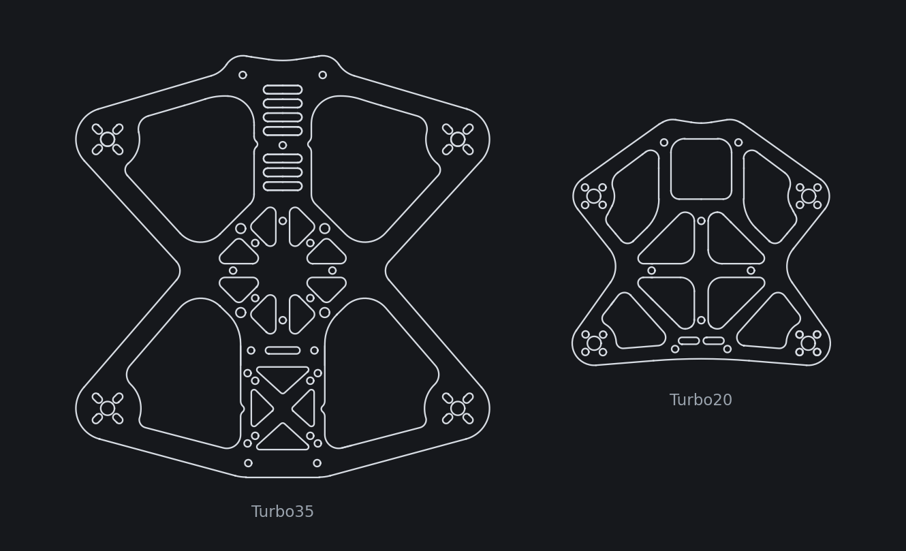
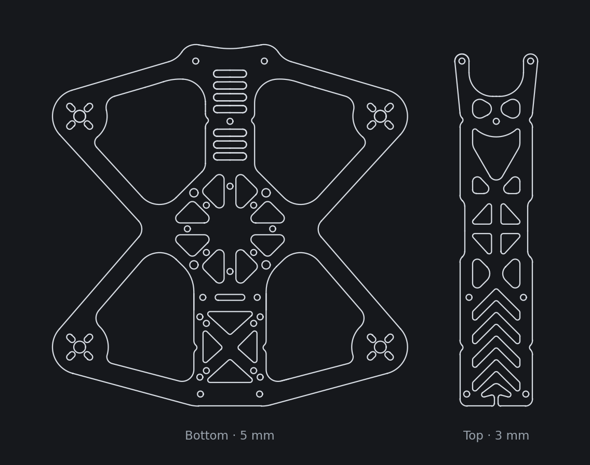
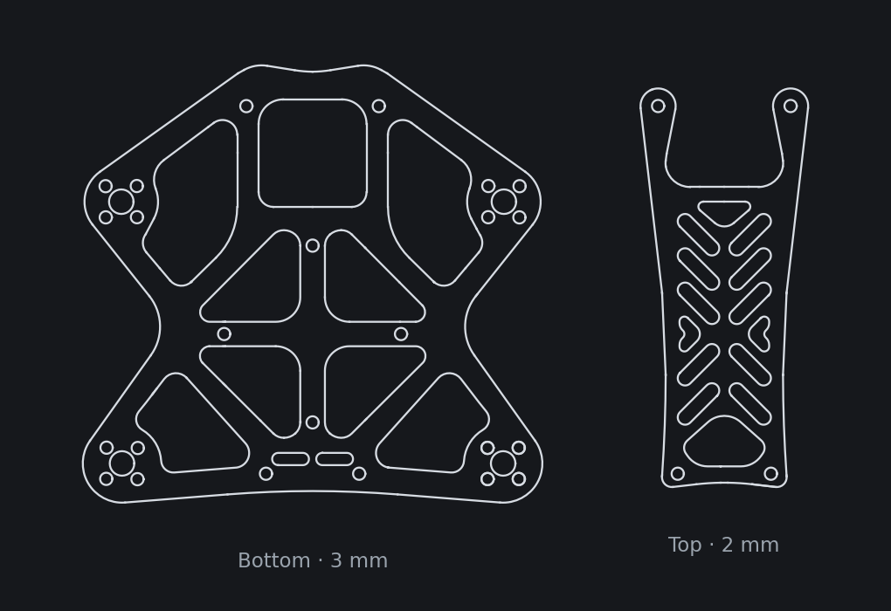

  <picture>
    <source media="(prefers-color-scheme: dark)" srcset="docs/img/mk-logo-white.svg">
    
  </picture>

# Turbo FPV Frames

**🌐 [Explore the frames in 3D →](https://moe-mk.github.io/turbo-frames/)**

Two open-source carbon fiber FPV frames by MK: the **Turbo35** (3.5") and the **Turbo20** (2"). Built for durability and designed around the DJI O4 Pro.
Download the DXFs, send them to any carbon cutting shop, and build.

---

## Turbo35 — 3.5"

The Turbo35 is made to be the ultimate bando basher and concrete-jungle crusher. It's designed for maximum durability, with clean footage and no props in view. It can be built under 250 g, but that's not what it's for.

### Built for durability

- **5 mm T700 unibody.** On a 5" frame a unibody can be a drawback. At 3.5" it's the point: one continuous plate, with no arm joints and no separate arms to snap.
- **Rounded everywhere.** The bottom plate is made of 159 curves with no sharp corners (tightest radius 1.0 mm), so there are no built-in weak points.
- **Checked in simulation** for weaker spots, and **tested by the community.**
- **M2 standoffs by design,** so they absorb hits instead of the carbon.

### Features

- **Flexible electronics mounting:** 20×20 or 30×30 stack, or a 25×25 AIO
- **Designed for the DJI O4 Pro,** and works with almost anything, including the DJI O3, HDZero and analog
- **Supports 12×12 and 9×9 motor patterns**
- **Built-in whip antenna slot** at the back of the top plate holds the antenna without any 3D-printed parts (tested)

| | |
|---|---|
| Props | 3.5" |
| Motors | 16xx–18xx, 3000–4000 KV |
| Motor mount | 9×9 or 12×12 (slotted, M2) |
| Battery | 4S 850–1000 mAh LiPo (or equivalent) |
| Wheelbase | ~160 mm (motor to motor, diagonal) |
| Bottom plate | 5 mm T700 carbon, unibody |
| Top plate | 3 mm T700 carbon |
| Standoffs | 10 × M2 25 mm |
| Frame weight | 75 g (85 g with hardware) |

---

## Turbo20 — 2"

The Turbo20 is the same durability-first design at 2". It's built around a single 25×25 AIO, **designed for the DJI O4 Pro** stacked directly on top, and it takes any 25×25 VTX.

| | |
|---|---|
| Props | 2" |
| Electronics | 25×25 AIO, with a 25×25 VTX stacked on top |
| Motor mount | 9×9 (M2) |
| Motors | 12xx–14xx, 4000–6000 KV |
| Battery | 4S HV 400–850 mAh |
| Designer's build | 1303.5 5500 KV motors, 4S 450 mAh HV |
| Wheelbase | ~94 mm (motor to motor, diagonal) |
| Bottom plate | 3 mm T700 carbon |
| Top plate | 2 mm T700 carbon |
| Standoffs | M2 |

---

## Why M2 standoffs?

The M2 standoffs are intentional: they're designed to absorb hits.

---

## Files

| File | Plate | Cut from |
|---|---|---|
| [`dxf/Turbo35_Bottom.dxf`](dxf/Turbo35_Bottom.dxf) | Turbo35 bottom (unibody) | 5 mm T700 carbon |
| [`dxf/Turbo35_Top.dxf`](dxf/Turbo35_Top.dxf) | Turbo35 top | 3 mm T700 carbon |
| [`dxf/Turbo20_Bottom.dxf`](dxf/Turbo20_Bottom.dxf) | Turbo20 bottom | 3 mm T700 carbon |
| [`dxf/Turbo20_Top.dxf`](dxf/Turbo20_Top.dxf) | Turbo20 top | 2 mm T700 carbon |

All DXFs are in **millimeters**. See [`BOM.md`](BOM.md) for the full hardware list and hole reference.

### 3D-printed parts (Turbo35)

Camera mounts (DJI O3, O4 Pro, HDZero Nano 90, 16 mm, GoPro), bumpers, antenna mounts, and a battery pad are in [`prints/`](prints/) and on [Printables](https://www.printables.com/model/983603-turbo-35-fpv-frame-parts). The printed parts are licensed CC BY-NC 4.0.

---

## License

Released under **[Creative Commons Attribution-ShareAlike 4.0](LICENSE)** (CC BY-SA 4.0).

You're free to build, modify, share, and sell these frames or cut sets, as long as you:
1. **Credit** the original Turbo frames and link back to this repo.
2. **Share alike:** release any modified version under the same license.

---

## Disclaimer

These designs are provided as-is, with no warranty. Check your build before you fly, and follow your local drone laws.
